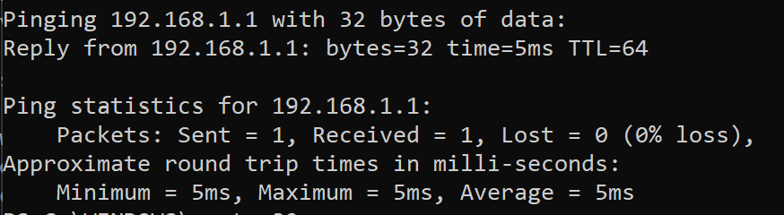

# ARP Traffic Monitor

A Scapy script captures ARP traffic and displays requests as readable descriptions of the sender and target IP addresses.

The capture uses an ARP filter and passes packets to a callback. For requests (`op == 1`), the callback reads the source and destination IP fields. `store=0` avoids retaining captured packets in the result list.

## Requirements

Complete the Python setup in the [main README](../README.md) and install [Npcap](https://npcap.com/#download) on Windows. See [Scapy's installation instructions](https://scapy.readthedocs.io/en/stable/installation.html) for capture-driver setup.

## Run

Open PowerShell as Administrator and run this command from the repository root:

```powershell
.\.venv\Scripts\python.exe arp_monitor\arp_monitor.py
```

The script captures on Scapy's default interface. Output appears when ARP requests are observed. An idle network may produce no output. It stops after 20 captured ARP packets, including replies that are not printed. Press Ctrl+C to stop it earlier.

## Demonstration

The Windows demonstration shows requests between `192.168.1.141` and `192.168.1.1` in both directions.


A separate ping to `192.168.1.1` returned one reply with a reported round-trip time of 5 ms during the demonstration. The monitor displays ARP requests, while the ping output shows ICMP reachability.



## Limitations and planned improvements

The monitor displays ARP requests and spoofing is not detected. Interface selection and a capture timeout would make it easier to use on computers with multiple adapters or quiet networks.
