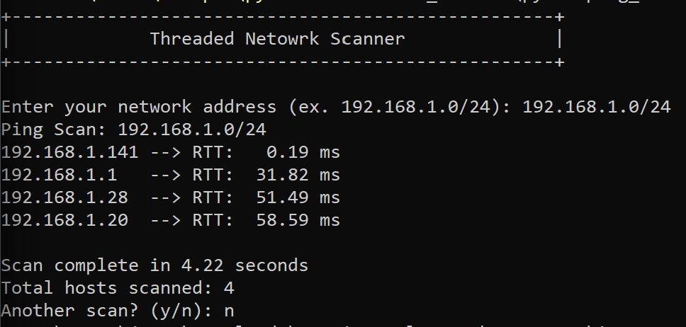

# Threaded ICMP Subnet Scanner

A command-line scanner uses `ipaddress` to enumerate host addresses in a subnet and a queue to distribute addresses among worker threads. `pythonping` sends two ICMP requests per address with a two-second timeout. Responding hosts are displayed with average round-trip times.

A thread lock protects the responding-host counter and result printing.

## Run

Complete the setup in the [main README](../README.md). Open PowerShell as Administrator and run this command from the repository root:

```powershell
.\.venv\Scripts\python.exe subnet_scanner\pythonping_scanner_threaded.py
```

Enter the subnet for a network you own or have permission to test, such as `192.168.1.0/24`. Enter a value explicitly. Pressing Enter selects the script's default: `10.0.1.0/24`.

Answer `n` after the scan. Start a fresh process for each scan because the current repeat-scan option accumulates the response count and creates additional worker threads.

## Demonstration

A Windows run against `192.168.1.0/24` reported four responding hosts and completed in 4.22 seconds.



The screenshot uses the original label `Total hosts scanned`. The current code labels this value `Responding hosts`. Hosts that do not answer ICMP may still be present on the network. The elapsed time describes this run only.

## Limitations and planned improvements

- Reset the response count and reuse workers when repeating scans.
- Validate subnet input and handle malformed or unsuitable ranges.
- Add a configurable worker limit, the current implementation starts 254 workers per scan.

## References

- [PythonPing](https://github.com/alessandromaggio/pythonping)
- [Python ipaddress documentation](https://docs.python.org/3/library/ipaddress.html)
- [Python queue documentation](https://docs.python.org/3/library/queue.html)
