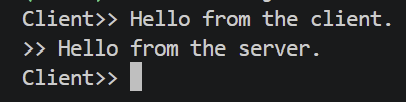
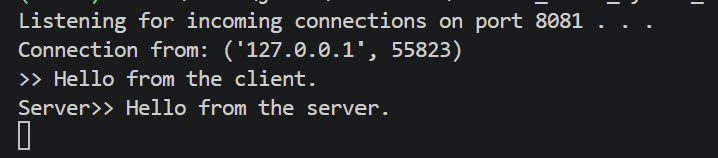

# TCP Command-Line Chat

A client and server exchange UTF-8 messages over TCP/IPv4 on port 8081. The conversation is turn-based: the client sends a message, then the server replies.

## Run

Complete the setup in the [main README](../README.md). Run both commands from the repository root in separate PowerShell terminals.

Start the server:

```powershell
.\.venv\Scripts\python.exe tcp_chat\chat_server.py
```

Start the client:

```powershell
.\.venv\Scripts\python.exe tcp_chat\chat_client.py
```

Both programs use `127.0.0.1`. Type a message at the client prompt, then enter a reply at the server prompt. Continue alternating between the two terminals.

Enter `q` at the client prompt to close the client connection. The server then waits for another client. Stop the server with Ctrl+C.

## Demonstration

The Windows demonstration shows a client message and server reply exchanged on port 8081.





## Limitations

The program supports one client and alternating messages. It does not support simultaneous sending, authentication, or encryption. Each receive operation reads up to 1024 bytes without message framing, and unexpected disconnects are not handled robustly.
