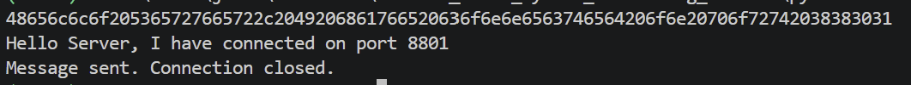
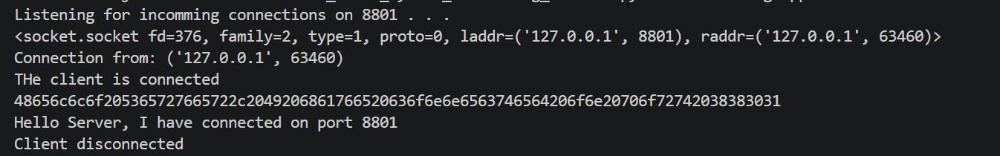

# TCP Client and Server

A TCP/IPv4 client sends a UTF-8 message to a server on port 8801. Both programs print the message and its hexadecimal representation. The server also sends a connection greeting, which the client does not read.

## Run

Complete the setup in the [main README](../README.md). Run both commands from the repository root in separate PowerShell terminals.

Start the server:

```powershell
.\.venv\Scripts\python.exe tcp_client_server\network_server.py
```

Start the client:

```powershell
.\.venv\Scripts\python.exe tcp_client_server\network_client.py
```

Both programs use `127.0.0.1`, so they run on the same computer. The client sends its message and closes. The server prints the received message and waits for another connection. Stop the server with Ctrl+C.

## Demonstration

The Windows demonstration shows a connection on port 8801 and matching message text and hexadecimal output at both endpoints.





## Implementation

The server uses `bind`, `listen`, and `accept` to receive connections. The client uses `connect` to establish the connection. Text is encoded as UTF-8 bytes before transmission and decoded after reception.

## Limitations

The server handles one connection at a time and reads up to 1024 bytes once per connection. The protocol does not define message boundaries or handle unexpected disconnects robustly. Transport is unencrypted and unauthenticated.
